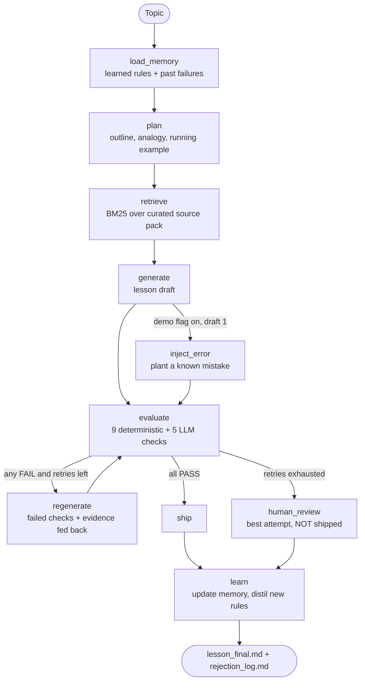

# Self-Evaluating Lesson Content Generator

An agentic system that **writes a beginner lesson, grades it against a hard pass/fail rubric, and
rewrites it until it is good enough to ship**, before a human ever sees it. It also **remembers
its failures across runs** and sharpens its own prompts and judge over time.

Built for the NxtWave *GenAI Engineer – Content Systems* take-home. Topic: **Introduction to RAG**.
Target learner: a 12th-pass student from India, non-English-medium background, starting from zero.

**Author:** Anurag Kumar

---

## 1. What it does in one picture



Max attempts = 1 + `MAX_RETRIES` (default 2), so the loop **always terminates**.

## 2. The rubric (14 hard pass/fail checks, no partial credit)

| ID | Check | Dimension | How it is judged |
|---|---|---|---|
| D1 | All required sections present | coherent flow | Python |
| D2 | Flesch Reading Ease ≥ 60 | beginner-friendly language | Python |
| D3 | Avg sentence ≤ 17 words, none > 32 | beginner-friendly language | Python |
| D4 | No banned hard words (utilize, leverage, paradigm …) | beginner-friendly language | Python |
| D5 | Every technical term used is defined in Key Words | no unexplained jargon | Python |
| D6 | Every acronym written in full once | no unexplained jargon | Python |
| D7 | Example section + ≥ 2 examples/analogies | teaches by example | Python |
| D8 | 900–2300 words | covers key points | Python |
| D9 | ≥ 3 quiz questions, each with an answer | coherent flow | Python |
| J1 | No claim contradicts the source facts or a known misconception | accurate & grounded | LLM judge |
| J2 | All 7 must-cover key points taught | covers key points | LLM judge |
| J3 | Concrete running example + everyday analogy | teaches by example | LLM judge |
| J4 | Nothing used before it is explained; logical order | coherent flow | LLM judge |
| J5 | Simulated learner ("Ravi", Hindi-medium 12th pass) has no blocking confusion | beginner-friendly language | LLM learner persona |

A lesson ships **only if all 14 pass**. An LLM fail is only accepted **with a quoted piece of evidence**;
a fail without evidence is overturned and logged (this cuts noisy, made-up rejections).

## 3. Setup

Needs Python 3.10+ and a free Groq API key from https://console.groq.com/keys

```bash
git clone https://github.com/Anurag308d/NxtWave_AnuragKumar_Assignment_GenAI.git
cd NxtWave_AnuragKumar_Assignment_GenAI
python -m venv .venv
# Windows: .venv\Scripts\activate      macOS/Linux: source .venv/bin/activate
pip install -r requirements.txt
copy .env.example .env      # macOS/Linux: cp .env.example .env
# then open .env and paste your key: GROQ_API_KEY=gsk_...
```

## 4. Run

```bash
python main.py run                        # full loop on "Introduction to RAG"
python main.py run --inject factual       # plant "RAG retrains the model" -> evaluator must catch it
python main.py run --inject all           # factual + jargon + hard vocabulary errors
python main.py memory                     # what the system has learned across runs
python main.py feedback D5 "Always define 'query' in Key Words"   # human feedback -> memory
python main.py reset-memory
streamlit run app.py                      # visual demo: live loop, rubric table, log, memory
python -m pytest -q                       # offline tests (no API key needed)
python main.py run --mock                 # whole pipeline offline with a scripted mock LLM
```

Every run writes to `outputs/<run_id>/` (and a copy in `outputs/latest/`):

| File | What |
|---|---|
| `lesson_final.md` | the passing lesson (or best attempt with a NOT SHIPPED banner) |
| `rejection_log.md` | per attempt: what failed, why, the evidence, the fix asked for, and **what changed on the retry** (checks fixed, regressions, offending sentence removed or not, stats before → after) |
| `run.json` | full machine-readable trace |
| `attempts/attempt_N.md` | every draft |

## 5. Self-evolving memory

`memory/memory.db` (SQLite) persists across runs:

- **Generator side (prompts evolve):** when the same check has failed ≥ 2 times across runs, an LLM
  distils one short rule from the actual failure reasons, e.g. *"Re-read every bold term and make sure
  it is in Key Words"*. Active rules are injected into every future generation prompt. If a rule does not
  stop the failures, it is re-distilled into v2, v3 …
- **Evaluator side (rubric sharpens):** concrete past failures (with evidence) are shown to the judge as
  "this must fail", so it recognises real problems more consistently.
- **Human feedback:** `python main.py feedback <check> "<rule>"` saves a reviewer's note as a rule.
- **Clean learning:** attempts with a deliberately injected error are logged but **never learned from**.

## 6. Project layout

```
lesson_agent/
  graph.py       LangGraph state machine (nodes, routing, retry cap)
  rubric.py      14 checks: 9 deterministic in Python + definitions of 5 LLM checks
  evaluator.py   runs the rubric, LLM judge + simulated learner, evidence rule
  prompts.py     every prompt in one place
  memory.py      SQLite memory: events, learned rules, judge examples
  sources.py     source pack loader + BM25 retriever (grounding)
  inject.py      deliberate error injection for the demo
  llm.py         Groq client: retries, rate-limit backoff, JSON repair, model fallback
  report.py      lesson + rejection log writer
  mock_llm.py    offline scripted LLM for tests
sources/rag.md   31 verified facts, 7 misconceptions, 7 must-cover key points
docs/ARCHITECTURE.md   design decisions and trade-offs
app.py           Streamlit demo
main.py          CLI
tests/           offline tests
```

## 7. Design decisions

See **[docs/ARCHITECTURE.md](docs/ARCHITECTURE.md)** for why this structure, these components,
this evaluator, and the trade-offs.
